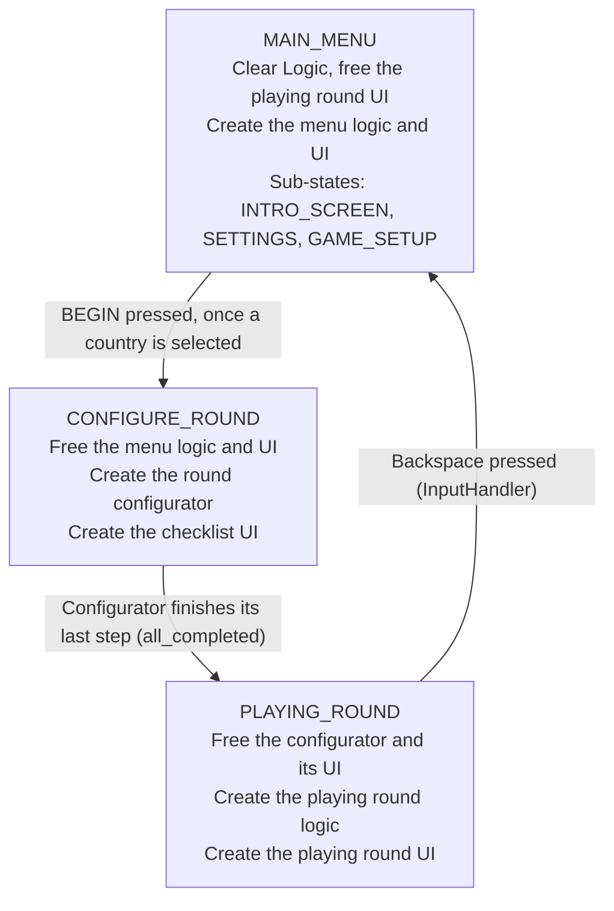

# Politics: Project Onboarding

Politics is a 4X-style strategy game built in Godot 4.5 (Forward Plus). Today it runs from a main menu through country selection (or loading a save) and round setup into a playing-round shell, and a round can be saved with F5.

- **Working now:** pick one of six countries (America, China, Germany, Israel, Russia, UK), press BEGIN, and watch the round get assembled with two random opponents. You land in a playing round where a top bar shows your country's money, public image, life expectancy and population, and END TURN steps through the countries in initiative order. After the last country the phase advances and the turns start over.
- **Saving and loading:** F5 in the playing round writes one save file. LOAD GAME in the menu lists it, and loading rebuilds the round through the same setup steps as a new game.
- **Stubbed:** the phases (economic, proxy war, upkeep) have names and a cycle but no gameplay behind them, and nothing starts the first phase yet (see Known gaps).
- **Focus so far:** the state progression from menu to round, the turn and phase system, and save and load, built so each piece has one job and can be swapped or extended without touching the others.

## Project layout

Scenes are grouped by game state, and scripts are split into a logic tree and a UI tree that mirror each other.

| Path | What lives there |
| --- | --- |
| `Data/Country_Data/` | One JSON file per country with its base values (see Country data). Adding a file adds a country to the selection list. |
| `Scenes/main_scene.tscn` | The entry scene (`run/main_scene`): `StateRouter`, `Logic`, `UI`. |
| `Scenes/MainMenu/` | `Core/` holds the menu logic and UI scenes. `Panels/RoundConfig/` holds the round config panel and its country entry. `Panels/LoadPanel/` holds the load panel and its save entry. |
| `Scenes/ConfigureRound/` | Everything that exists while a round is assembled: the round config node, the round configurator (logic and UI), the country manager, the state manager. |
| `Scenes/PlayingRound/` | `playing_round_logic.tscn` and `playing_round_ui.tscn`. |
| `Scenes/country.tscn` | One country instance, with `Data` and a `Parameters` tree (see Country data). |
| `Scenes/city.tscn` | One city, instanced under a country's `Settlements` (see Settlements). |
| `Scripts/Autoload/` | The three autoloads: `game_state.gd` (`GameState`), `save_writer.gd` (`SaveWriter`) and `scene_loader.gd` (`SceneLoader`). |
| `Scripts/Logic/` | `state_router.gd`, `round_config.gd`, and one folder per area: `MainMenu/` (with `RoundConfig/` and `LoadPanel/` for the panels' logic), `RoundConfigurator/`, `PlayingRound/`. |
| `Scripts/UI/` | UI scripts, one folder per area: `MainMenu/` (with `Panels/RoundConfig/` and `Panels/LoadPanel/`), `ConfigureRound/`, `PlayingRound/` (with `TopBar/`: `top_bar.gd` and `parameter_label.gd`). |
| `Scripts/Country/` | `Countries/country.gd`, `Settlements/` (`settlements.gd`, see Settlements), `Parameters/` (one script per parameter node: `population.gd`, `economy.gd`, `public_image.gd`, and `Population/` for the population's children) and `CountryManager/` (manager, logic, factory, list). `country_manager.gd` has `get_player_country()`, which returns the country in `CountryList` whose `data.is_player` is true. |
| `Scripts/MainScene/` | `main_scene.gd` and `logic.gd`, the registry (see below). |
| `Scripts/MainMenu/` | `main_menu_router.gd`, the menu's own router, and `Panels/begin_button.gd`. |
| `Scripts/PlayerManager/` | `player_data.gd`, the `Data` node on each country, the central place to read and write its values (see Country data). |
| `Scripts/Data/` | Static helpers for reading files: `country_files.gd` (country JSON), `mortality_files.gd` (WHO mortality JSON), `risk_factor_files.gd` (risk factor JSON) and `save_file.gd` (save files). Not nodes; callers `preload` them. |
| `Data/Maps/` | Land maps of real areas for map types, read through `Scripts/Data/map_files.gd`. `earth_land.json` is the whole Earth. |
| `Data/Mortality/`, `Data/RiskFactors/` | WHO deaths and population per age band for each country, and relative risks per risk factor. See `docs/life_expectancy.md`. |

Three scripts sit outside this pattern: `Scenes/MainMenu/Buttons/new_game_button.gd` lives beside the scenes, and `Scripts/MainMenu/Panels/begin_button.gd` and `Scripts/MainMenu/main_menu_router.gd` live in a `MainMenu` folder at the scripts root.

## Architecture principles

Every piece has one job, is handed what it needs, and is created and freed by the same owner.

- **Logic and UI are separate scenes.** Each state has a logic scene (added under `Logic`) and a UI scene (added under `UI`). UI scripts read from logic through `initialize(...)`; logic never reaches into UI.
- **Dependencies are injected.** The creator calls `initialize(...)` with what the new node needs. A node does not search the tree for its collaborators. The one lookup a script makes is `@onready` on its own children.
- **Systems are registered, not found.** Anything that must be reachable by others registers with the `Logic` node (`logic.register("name", node)`) and is read with `logic.get_system("name")`.
- **Wiring uses signals, set up in the scene.** Example: the entry factory emits `entry_created`, and a `[connection]` in `round_config_panel.tscn` routes it to the selector.
- **The router owns meta-game states only.** Main menu, configure round, playing round (credits and the like later). Setup that exists only briefly belongs in the round configurator. Menu panels belong to the main menu's own router, not the global one.
- **Scenes load when needed, through `SceneLoader`.** Scripts hold scene paths as constants and call `SceneLoader.instantiate(PATH)` at the point of use. They do not `preload` scenes or keep `PackedScene` variables. Scripts can still be preloaded.
- **Systems describe their own saved state.** Each stateful system has `get_save_data()` and `load_save_data(data)`. The save writer collects, and loading rebuilds through the normal setup steps instead of a separate path.
- **Autoloads are for things that cannot be injected.** `GameState`, `SaveWriter` and `SceneLoader` exist because callers (buttons, the input handler, factories, steps) are not handed a reference to them. Anything else is registered or injected.
- **File reading goes through `Scripts/Data/`.** Country JSON is read only through `country_files.gd` (`find_paths()`, `read(path)`, `find_by_id(id)`) and saves only through `save_file.gd` (`read(path)`, `find_player_id(save_data)`). These are static functions on scripts that callers `preload`, so nothing is registered or injected.
- **Small scripts over big ones.** A new concern gets a new script, even a short one. Existing scripts do not grow code that does not belong to them.

## Main scene and the Logic registry

`main_scene.tscn` holds a `StateRouter`, a `Logic` node that doubles as a registry of live systems, a `UI` control and a `3D` node (`Node3D`). On startup `main_scene.gd` calls `state_router.initialize(logic, ui, three_d)`, where `three_d` is the `3D` node (`Scripts/3D/3d.gd`, which holds `hex_tile_grid`). The router passes it to the round configurator through `configurator.initialize(three_d)` right after adding it, before the steps run.

`Logic` (`Scripts/MainScene/logic.gd`) keeps a `systems` dictionary and has four functions:

- `register(name, node)` stores a system.
- `get_system(name)` returns it, or `null`.
- `release(name)` removes one system from the registry and the tree, then frees it.
- `clear()` empties the registry and frees every child of `Logic`. Children leave the tree immediately, so a node of the same name created in the same frame keeps its name.

| Name | Registered by | Freed by |
| --- | --- | --- |
| `main_menu` | Router, when the main menu is created | Router on `CONFIGURE_ROUND` |
| `round_config` | Main menu router, when the menu enters `GAME_SETUP` or `LOAD_GAME` | Round configurator when its checklist completes |
| `round_configurator` | Router, on `CONFIGURE_ROUND` | Router on `PLAYING_ROUND` |
| `country_manager` | `CreateCountryManager` step | `logic.clear()` on `MAIN_MENU` |
| `state_manager` | `CreateStateManager` step | `logic.clear()` on `MAIN_MENU` |
| `map_graph` | `CreateMapGraph` step | `logic.clear()` on `MAIN_MENU` |
| `playing_round` | Router, on `PLAYING_ROUND` | `logic.clear()` on `MAIN_MENU` |

The UI side is not covered by `clear()`. The router keeps its own references to the main menu UI, the round config panel, the checklist UI and the playing round UI, and frees them itself.

## State flow

The game moves through three states in `GameState`, and `state_router.gd` reacts to each change by creating the new state's scenes and freeing the old one's.



Four things request a state change today: the BEGIN button and the LOAD button both ask for `CONFIGURE_ROUND`, the configurator asks for `PLAYING_ROUND` when its last step is done, and the playing round's `InputHandler` (`playing_round_input.gd`, under `Logic` in `playing_round_logic.tscn`) asks for `MAIN_MENU` when Backspace is pressed. `GameState` is global; `MainMenuState` lives inside the menu scene and only changes which panel shows.

What happens, in order:

1. **Startup.** `main_scene.gd` calls `state_router.initialize(logic, ui, three_d)`, which runs the `MAIN_MENU` branch for the initial state.
2. **Opening setup.** NEW GAME moves `MainMenuState` to `GAME_SETUP`, and LOAD GAME moves it to `LOAD_GAME`. The menu router adds the matching panel. The global state stays `MAIN_MENU`.
3. **BEGIN or LOAD.** With a country (or a save) selected, the button requests `CONFIGURE_ROUND`. `GameState.change_state` sets the state and emits `state_changed`.
4. **Configure.** The router frees the menu, then creates the round configurator and its checklist UI. The configurator builds the systems and the player's country.
5. **Handoff.** On `all_completed` the configurator releases the round config and requests `PLAYING_ROUND`.
6. **Play.** The router frees the configurator and its UI, then creates the playing round logic and UI, wired to the systems already in the registry. When it entered `CONFIGURE_ROUND` it already asked `SceneLoader` to start loading those two scenes in the background.

## Main menu and panels

The main menu is a logic scene plus a UI scene, and its own small state machine (`INTRO_SCREEN`, `SETTINGS`, `GAME_SETUP`, `LOAD_GAME`) decides which panel is showing.

- **`main_menu_logic.tscn`** holds `MainMenuState` (the sub-state machine; `ui_cancel` calls `go_back()` through `MainMenuInput`) and `MainMenuRouter` (`Scripts/MainMenu/main_menu_router.gd`).
- **`main_menu_ui.tscn`** holds the NEW GAME and LOAD GAME buttons and a `Panels` node that other panels are added to.
- **`MainMenuRouter`** owns panel spawning. The global router calls `main_menu_logic.initialize(ui, logic)` when it creates the menu, and `MainMenuRouter` listens to `MainMenuState.state_changed`. `GAME_SETUP` creates the round config node (once) and the round config panel. `LOAD_GAME` creates the round config node and the load panel. Every branch frees the other panel first, so only one panel is up. `INTRO_SCREEN` and `SETTINGS` free both.

### Round config panel

The round config panel (`round_config_panel.tscn`) is a logic-and-UI pair in one scene:

| Node | Script | Job |
| --- | --- | --- |
| `RoundConfig` (root) | `round_config_panel.gd` | Receives the config and passes it to the three nodes below. |
| `Logic/CountryEntryFactory` | `country_entry_factory.gd` | Reads each country JSON listed in the config, builds one entry per country, and puts them in the list. |
| `Logic/CountrySelector` | `country_selector.gd` | Listens to every entry, records that a selection happened, and writes the chosen id to the config. |
| `Panel/BeginButton` | `begin_button.gd` | Does nothing until the selector reports a selection, then requests `CONFIGURE_ROUND`. |
| Each entry (`round_config_country_container.tscn`) | `round_config_country_entry.gd` | A toggle button in a shared `ButtonGroup`. Shows the country name and emits `selected(id)` when pressed. |

How a click becomes a stored choice:

1. `round_config_panel.initialize(config)` hands the selector to the button, the config to the selector, and the config plus the list node to the factory.
2. For each file in `config.country_files`, the factory parses the JSON, instantiates an entry, calls `entry.initialize(country_data, group)`, emits `entry_created(entry)`, and adds it to the list.
3. A scene connection routes `entry_created` to `CountrySelector.track_entry`, which connects the entry's `selected` signal to the selector.
4. Pressing an entry emits `selected(id)`. The selector sets `has_selection` and calls `config.select_country(id)`, which stores `player_country_id`.
5. BEGIN checks `has_selection`. If true, it requests `GameState.State.CONFIGURE_ROUND`.

A rebuilt panel gets a new selector, so `has_selection` always starts false.

### Load panel

`load_game_panel.tscn` follows the same logic-and-UI pattern as the round config panel, with one save slot.

| Node | Script | Job |
| --- | --- | --- |
| `LoadPanel` (root) | `load_game_panel.gd` | `initialize(config)` hands the selector and config to the button and the list to the factory. |
| `Logic/SaveEntryFactory` | `save_entry_factory.gd` | If `SaveWriter.SAVE_PATH` exists, parses it, looks up the player's country name from the country JSON, and creates one entry. |
| `Logic/SaveSelector` | `save_selector.gd` | Tracks entries through a scene connection and records `has_selection` and `selected_path`. Clears them when an entry is deleted. |
| `Panel/LoadButton` | `load_button.gd` | Does nothing until a save is selected, then parses the file into `config.save_data`, sets `config.player_country_id` from the save, and requests `CONFIGURE_ROUND`. |
| Entry (`load_container.tscn`) | `load_game_entry.gd` | A toggle button showing the player's country name. Emits `selected(path)`. Its X button deletes the file, emits `deleted` and frees the entry, with no confirmation. |

## Round configurator

The round configurator runs a list of steps in order, builds the systems a round needs, creates the player's country and the opponents, sets the turn order, restores a saved state if one is loaded, and then hands the game to the playing round. It exists only during `CONFIGURE_ROUND`.

**Structure.** `round_configurator_logic.tscn` is a `RoundConfigurator` node whose children are the steps. Scene-tree order is execution order. Each step is a node with a script that has one function, `run(configurator)`. The configurator exposes `logic` (its parent, the registry) and `config` (the registered `round_config` node), so a step reaches everything through the configurator.

| Order | Step node | Script | What it does |
| --- | --- | --- | --- |
| 1 | `CreateCountryManager` | `create_country_manager_step.gd` | Instantiates the country manager under `Logic`, registers it as `country_manager`, and calls its `initialize()`. |
| 2 | `CreateStateManager` | `create_state_manager_step.gd` | Instantiates the state manager (with `TurnManager` and `PhaseManager`) under `Logic` and registers it as `state_manager`. |
| 3 | `CreatePlayerCountry` | `create_player_country_step.gd` | Creates the country whose id is `config.player_country_id` and sets its `is_player`. |
| 4 | `CreatePlayers` | `create_players_step.gd` | Creates the opponents through the factory. With no save it picks `config.player_count - 1` random countries (never the player's); `player_count` is 3 and is not yet editable in the panel. With `config.save_data` it creates the saved non-player countries instead. |
| 5 | `CreateMapGraph` | `create_map_graph_step.gd` | Instantiates `map_graph.tscn` under `Logic` and registers it as `map_graph` (it lasts into the playing round). If `config.save_data` has a `map` key it calls `load_save_data(save_data["map"])`; otherwise (a new game, or a save from version 6 or earlier) it calls `generate(config.get_map_dimensions(), config.map_type)`. |
| 6 | `CreateMapConstructor` | `create_map_constructor_step.gd` | Instantiates `map_constructor.tscn` under `Logic` without registering it, calls `initialize(configurator.three_d, map_graph)` and `construct()`, then removes and frees it. |
| 7 | `SetTurnOrder` | `set_turn_order_step.gd` | Sorts the created countries by `country_initiative`, highest first (ties keep creation order), passes the order to `TurnManager.set_turn_order()`, then calls `next_turn()` so the top country is current. |
| 8 | `RestoreSavedState` | `restore_saved_state_step.gd` | Does nothing unless `config.save_data` is set. Otherwise calls `load_save_data` on the state manager, phase manager and turn manager, which overwrites the order and index `SetTurnOrder` just set. Then `restore_countries` matches each country to its saved entry by `data.id` and calls `country.load_save_data`, which overwrites the base values from the JSON. |

**How it runs.**

- `_ready()` defers `run_steps()` by one step, so steps can add systems to `Logic` after the configurator has finished entering the tree.
- `run_steps()` loops over its children and runs `await step.run(self)`. A step is complete when `run()` returns. A step that needs time awaits a signal or timer inside `run()`.
- After each step the configurator emits `step_completed(step)`. After the last step it emits `all_completed`.
- On `all_completed` the configurator releases the `round_config` node (which also discards any loaded `save_data`) and requests `GameState.State.PLAYING_ROUND`. The router then frees the configurator and its children.

**Checklist UI.** `round_configurator_ui.tscn` is created by the router next to the configurator. For each step it adds a read-only checkbox labelled with the step's node name (for example, `CreateCountryManager` shows as "Create Country Manager") and ticks it on `step_completed`. The steps know nothing about the UI.

## Country data

Each country is a `country.tscn` instance. A country's values that change during play live on the parameter nodes under `Parameters`. `Data` (`player_data.gd`) is the central place to read and write them.

```
Country                  country.gd: holds the nodes below, saves and loads the country
├─ Data                  player_data.gd: id, is_player, name, initiative, plus pass-through fields
├─ Parameters
│  ├─ Population         population.gd: wires its children, merges their save data
│  │  ├─ Count           population_count.gd: population_count, the cities' band populations added up
│  │  ├─ AgeBands        age_band.gd per band (7 WHO bands)
│  │  ├─ RiskFactors     risk_factor.gd per factor (Smoking)
│  │  ├─ Mortality       mortality.gd: death rate per band
│  │  ├─ LifeExpectancy  life_expectancy.gd: life_expectancy, calculated
│  │  └─ Workers         workers.gd: workers
│  ├─ Economy            economy.gd: money
│  ├─ PublicImage        public_image.gd: public_image
│  └─ Army, Production, Factions   (no scripts yet)
└─ Settlements           settlements.gd: home for the country's settlements
   └─ City               city.tscn (city.gd): one city
      └─ Population      city_population.gd: band_populations, the people living in the city
```

`AgeBands`, `RiskFactors`, `Mortality` and `LifeExpectancy` are the life expectancy engine. `docs/life_expectancy.md` covers them.

**Parameter nodes own the values.** Each value is a plain variable with a `set_<name>(value)` function that stores it and emits `<name>_changed(new_value)` (for example `set_money()` and `money_changed`). Anything that changes the value calls that function, including the node's own `load_save_data`. Writing the variable directly stores it without emitting. Each node has its own `get_save_data()` and `load_save_data(data)` for its keys. Logic for a parameter (for example, how population grows) belongs in its script.

**`Data` only reads and writes.** It stores `id`, `is_player`, `country_name` and `country_initiative` itself. Its other fields have a getter and setter that go straight to the parameter node, so `data.country_money = 5` calls `economy.set_money(5)`:

| `Data` field | Goes to |
| --- | --- |
| `country_population_count` | `Count.population_count` (read only) |
| `country_life_expectancy` | `LifeExpectancy.life_expectancy` (read only) |
| `country_target_life_expectancy` | `LifeExpectancy.target_life_expectancy` |
| `country_mortality` | `Mortality.mortality` / `set_mortality()` |
| `country_risk_prevalence` | `Mortality.risk_prevalence` / `set_risk_prevalence()` |
| `country_workers` | `Workers.workers` / `set_workers()` |
| `country_money` | `Economy.money` / `set_money()` |
| `country_public_image` | `PublicImage.public_image` / `set_public_image()` |

`Data` has no signals and no save or load functions. `country.gd` calls `data.initialize(population, economy, public_image)` in `_ready()`, and `initialize` takes the population's children from `population.gd`'s references (`population.count`, `population.mortality`, `population.life_expectancy`, `population.workers`).

**`country.gd` saves and loads the country.** It has `@onready` references to `data`, `parameters`, `population`, `economy` and `public_image`. Its `get_save_data()` writes `id` and `is_player` from `Data`, then loops over the children of `Parameters` and merges in the save data of each one that has `get_save_data()`, then merges in `settlements.get_save_data()`. `load_save_data(save_data)` loops the same way and passes the save to each child that has `load_save_data()`, then to `settlements.load_save_data()`. Nodes without a script (Army, Production, Factions) are skipped, and a new parameter node with save functions is saved without editing `country.gd`.

**Base values come from JSON.** The factory's `configure_country` copies each key from the country's JSON file through `Data` when the country is created. `create_country` adds the country to the tree first, so `_ready()` has already connected `Data` to its nodes. Every key below is read unconditionally, so a JSON file missing one errors in the factory.

| JSON key | `Data` field | Stored on | Unit | Base values from |
| --- | --- | --- | --- | --- |
| `id` | `id` | `Data` | | |
| `country_name` | `country_name` | `Data` | | |
| `initiative` | `country_initiative` | `Data` | 1 to 5 | Game design |
| `money` | `country_money` | `Economy.money` | Billions of USD | Total household wealth, 2022 (UBS / Credit Suisse Global Wealth Databook 2022) |
| `public_image` | `country_public_image` | `PublicImage.public_image` | 0 to 10 | 5 for every country, a placeholder |
| `life_expectancy` | `country_target_life_expectancy` | `LifeExpectancy.target_life_expectancy` | Years | WHO life expectancy at birth, both sexes, 2023 (`WHOSIS_000001`). The engine calibrates to it; see `docs/life_expectancy.md`. |
| `risk_prevalence` | `country_risk_prevalence` | `Mortality.risk_prevalence` | Shares per exposure level | Empty `{}` for every country; no source found yet |
| `workers` | `country_workers` | `Workers.workers` | People per role | |

The factory also reads `Data/Mortality/mortality_<id>.json` into `country_mortality`, after the target and before the risk prevalence, because setting it calibrates against the target.

**Population has one source: the cities.** The country JSON has no population. The factory reads the WHO mortality file (2023) and calls `settlements.settle(mortality)`, which puts every band's WHO population into the one city. When the city's `Population` emits `band_populations_changed`, a `[connection]` in `country.tscn` runs `Count._on_band_populations_changed`, which sets each `AgeBand.population` to the cities' total for that band, adds the bands up and stores the total with `set_population_count()`, so `population_count_changed` reaches the top bar.

Godot's JSON parser reads every number as a float, so these values are floats. The labels format them for display.

## Settlements

`Settlements` (`Scripts/Country/Settlements/settlements.gd`) is a child of each `country.tscn`, beside `Parameters`. It holds all settlement code. The plan: each settlement (a city, or the country's rural areas) owns its own population, production and economy, and the country's values become totals added up from its settlements. Its one child is `City`, an instance of `Scenes/city.tscn`. Cities hold the people; the country holds the epidemiology. Death rates, risk factors and life expectancy stay national under `Parameters/Population`, since WHO life expectancy is a national figure, and they read population per band from the cities' total.

| Symbol | Meaning |
| --- | --- |
| `city.gd` | `@onready population` (its `Population` child). Saves and loads through it. |
| `city_population.gd` (`City/Population`) | `band_populations`: people per age band, keyed like the mortality file (`"0-4"` … `"70+"`). `set_band_populations()` stores it and emits `band_populations_changed`. Saves it under `population` and loads it through `set_band_populations()`. |
| `settlements.gd` `settle(mortality)` | Puts every band's population from the WHO mortality file into the first city. Called by the factory once per country, so today the whole country lives in one city. |
| `settlements.gd` `band_population(key)` | One band's population added up over every city. `Count` reads it. |
| `settlements.gd` `get_save_data()` | `{"settlements": [...]}`: one entry per city, in child order, each the city's own `get_save_data()`. |
| `settlements.gd` `load_save_data(data)` | Gives entry *n* of `data["settlements"]` to city *n*. A save without `settlements` (version 7 or 6) has `population` at the country level; it goes to the first city. `country.gd` calls both after its `Parameters` loop. |
| `population.gd` `initialize(settlements)` | Called by `country.gd` in `_ready()`; hands `Settlements` to `Count`. |

Cities are saved as a list under `settlements` (version 8), because each city writes the same `population` key and merging them into the country would keep only the first. Loading matches entries to cities by position, which works while the cities are fixed in `country.tscn`. Once cities are created in play, `load_save_data` has to create one city per saved entry instead, and the `Count` connection, which today is a `[connection]` to the fixed `Settlements/City/Population`, has to be made in code as each city is created.

Checked headless in Godot 4.5.1 (2026-10-23), building each country the way `country_factory.gd` does: every country's population equals its WHO total and its life expectancy equals its target. In version 8 (also checked headless, 2026-10-23), a country's save holds `settlements` with one city, and loading it with one band changed moves the city, the band and the country total together. A version 7 country (`population` at the top level) loads into the city the same way. The game itself was not run.

## Map

The map is split in two: a graph that holds the map's logical data for the whole round, and a constructor that builds the tiles from it during setup and is then freed.

- **`MapGraph`** (`map_graph.tscn`, `Scripts/Map/map_graph.gd`). Created by the `CreateMapGraph` step and registered as `map_graph`, so the playing round can read it with `logic.get_system("map_graph")`. `logic.clear()` frees it on `MAIN_MENU`.
- **`MapConstructor`** (`map_constructor.tscn`, `Scripts/Map/map_constructor.gd`). Created by the `CreateMapConstructor` step, handed the `3D` node and the graph, run, then removed and freed by the same step. It is not registered. Its child `TileFactory` (`Scripts/Map/tile_factory.gd`) builds one tile per cell under `3D/HexTileGrid`.
- **Tiles** stay under `3D/HexTileGrid` after the constructor is freed. `state_router.gd`'s `destroy_map()` frees them on `MAIN_MENU`. It runs at startup too, so any tile placed under `HexTileGrid` in the editor is freed before a round starts.

| Symbol | Meaning |
| --- | --- |
| `MapGraph.cells` | The graph: axial coordinate (`Vector2i(q, r)`) to that cell's `MapCell`. |
| `MapCell` (`Scripts/Map/map_cell.gd`) | One cell's logical data: `coordinate`, `terrain` and `neighbours` (the coordinates of the cells next to it). A `RefCounted`, not a node, so thousands of cells cost no scene tree nodes. `map_graph.gd` preloads it. |
| `MapCell.Terrain` | `LAND` or `WATER`. `terrain` is typed `int`, since an enum value is an `int`. |
| `TerrainGenerator` (`Scripts/Map/terrain_generator.gd`, child of `MapGraph`) | Hands terrain generation to the child node for the map type. `generators` maps each `RoundConfig.MapType` to its child; `generate(dimensions, map_type)` returns that child's terrain, keyed by column and row. A new map type is a value in `MapType`, a child node with a `generate(dimensions)` script, and an entry in `generators`. |
| `EarthTerrain` (`Scripts/Map/earth_terrain.gd`, child of `TerrainGenerator`) | The `EARTH` map type. Reads `Data/Maps/earth_land.json` through `Scripts/Data/map_files.gd` (`find_by_id("earth")`). Works at any map size. Runs three passes: threshold, island rescue, bridges. |
| `EarthTerrain.find_squares()` | The grid squares under a cell: the land map is spread over the whole hex map, odd rows shifted half a cell. |
| `EarthTerrain.LAND_THRESHOLD` | A cell is land when at least half its squares are land (0.5). |
| `EarthTerrain.ISLAND_THRESHOLD`, `ISLAND_MAX_SQUARES` | A cell is also land when a single landmass smaller than 200 squares (anything below Australia's 688) covers at least 25% of it on its own; other landmasses' squares in the cell do not count. Gives islands closer to their real shape: New Zealand becomes a chain of three tiles instead of two apart, and New Guinea, Borneo and Sulawesi fill out. `is_land()` applies both rules; `measure_landmasses()` counts each landmass's squares over the whole grid. |
| `EarthTerrain.count_landmasses()` | Land squares under a cell, per landmass number. `dominant()` is the landmass with the most squares in a cell. |
| `EarthTerrain.rescue_islands()` | A landmass counts as shown when it is the dominant landmass of some land cell. For every landmass not shown and of at least `MIN_RESCUE_SQUARES` (3) squares, roughly 35,000 km² near the equator, the water cell holding most of its squares becomes land; a landmass whose cells are all land already gets none (Sardinia). The minimum stops specks of 1 or 2 squares being blown up to whole tiles, which made solid east-west rows of land north of Australia; it costs Hawaii, Sicily, Fiji, Vanuatu, the Solomons and the Lesser Sundas. So islands smaller than half a cell (Britain, Japan, Sri Lanka, New Zealand, the Philippines, Cuba, Hawaii and the like) get at least one tile, without lowering the threshold, which would bloat every coastline. |
| `EarthTerrain.bridge_landmasses()` | A landmass whose cells (land cells it dominates) fall into several disconnected pieces is joined up: each smaller piece is connected to the largest along `cheapest_path()`, and the water cells on that path become land. Fixes narrow land such as Panama between North and South America. Different landmasses are never bridged. |
| `EarthTerrain.cheapest_path()` | Shortest path counting only water cells, moving only through cells that hold squares of that landmass, so a bridge follows the real land. 0-1 breadth-first search: land steps cost 0, water steps cost 1. |
| `EarthTerrain.neighbours()` | The six neighbouring cells in column and row form; odd rows are shifted half a cell right, matching `MapGraph`. |
| `Data/Maps/earth_land.json` | `rows`: 180 rows of 360 numbers, one per 1° square from 90° N and 180° W. Each is 0 for water or the number of the Natural Earth land polygon the square's centre lies in. Equirectangular (longitude and latitude both linear, `projection` in the file), so high latitudes such as Alaska are stretched east-west, by 2 at 60°. Built from Natural Earth 1:110m land (public domain); each polygon is a separate landmass, so islands stay separate even where the 1° grid closes a strait. The build script is not in the project. |
| Earth on the small map | Checked in Python with the same sampling and passes: 16 islands rescued, 4 bridge cells (Panama among them), 35.2% of cells land; Britain 2 tiles, Ireland 1, Iceland 1, Japan 3, Cuba 1, Hispaniola 1, Sri Lanka 1, Luzon 1, Mindanao 1, Madagascar 5, Tasmania 1, New Zealand 3. Land is more than Earth's 29% because the projection enlarges Antarctica and the far north. Path and tie choices can differ from the Python check. A Kavrayskiy VII version was tried and dropped: its curved edge left empty ocean between Alaska and Chukotka and cost Australia a column. Miller versions with the poles cropped were previewed and not chosen. |
| `RandomTerrain` (`Scripts/Map/random_terrain.gd`, child of `TerrainGenerator`) | The `RANDOM` map type: continents from seeds. The rows below are its symbols. |
| `RandomTerrain.generate()` | Builds a height per cell from three parts, then makes the highest `LAND_SHARE` of cells land. The parts: the nearest continent's height at the cell's warped position, plus coastline detail, minus the edge fade. |
| `CONTINENT_COUNT`, `place_continents()` | Up to 6 continent centres, placed at random inside the margins (`CONTINENT_MARGIN`: 12% of the width, 15% of the height) and at least `CONTINENT_SPACING` (a 4.2th of the map width) apart. Each gets a random angle, a stretch from 1 to `CONTINENT_STRETCH_MAX` (2.2) and a radius from `CONTINENT_RADIUS_MIN` to `CONTINENT_RADIUS_MAX` (5 to 9 cells). Gives up after `PLACEMENT_ATTEMPTS` (5000), so a crowded map can get fewer. |
| `continent_height()` | 1 at a continent's centre, falling to 0 at its radius along the short axis, over a stretched ellipse. A cell takes the highest value of any continent. |
| `WARP_STRENGTH`, `WARP_FREQUENCY` | Two noise fields shift each cell's position by up to a few cells before measuring its distance to the continents, so the ellipses become irregular shapes. Stronger warp curls land into rings and strands. |
| `DETAIL_STRENGTH`, `DETAIL_FREQUENCY` | A finer noise field added to the height, which roughens coastlines and raises a few offshore islands. |
| `edge_fade()` | Lowers the height within `EDGE_FADE` (4) cells of the map border, so land rarely touches the edge. |
| `normalise()` | Rescales a noise field to mean 0 and standard deviation 1. Noise implementations differ in range, so the strengths above mean the same whatever the noise returns. |
| `create_noise()` | A `FastNoiseLite` with a random seed, the given frequency and octaves, and Godot's other defaults. |
| `find_positions()` | Each cell's real position on the hex layout (odd rows half a cell right, rows √3/2 apart), so shapes are not stretched. |
| `RandomTerrain.find_sea_level()` | The height below which `1 − LAND_SHARE` of cells fall, so land is always `LAND_SHARE` (0.29, roughly Earth's share) of the map, whatever the noise. |
| `MapGraph.DIRECTIONS` | The six axial neighbour offsets. |
| `MapGraph.to_axial()` | Turns a column and row into axial coordinates. The hexes are pointy-top (a vertex points up), and odd rows sit half a hex to the right, so the grid is a rectangle. |
| `MapGraph.generate(dimensions, map_type)` | Clears `cells`, creates `dimensions.x` columns by `dimensions.y` rows with terrain from `TerrainGenerator` for `map_type`, and links each cell to the neighbours that exist. |
| `RoundConfig.MapSize`, `MAP_DIMENSIONS` | Named map sizes and their columns by rows. `SMALL` is 74 by 46, Civilization's small map. |
| `RoundConfig.map_size` | The chosen size, `SMALL` by default. Nothing in the menu sets it yet. |
| `RoundConfig.MapType`, `map_type` | How terrain is made: `RANDOM` or `EARTH` (the default). Real geographic areas are further types. Nothing in the menu sets it yet, and it is not saved: a loaded game keeps its saved terrain. |
| `RoundConfig.get_map_dimensions()` | The dimensions of `map_size`, read by the `CreateMapGraph` step. |
| `MapGraph.get_save_data()` | `{"cells": [[q, r, terrain], ...]}`. JSON cannot key on `Vector2i`, so cells are saved as arrays. Neighbours are not saved. |
| `MapGraph.load_save_data()` | Clears `cells`, recreates each saved cell with its terrain (the parser reads numbers as floats, so each is cast back to int), then runs `connect_neighbours()`. |
| `MapConstructor.three_d` | The main scene's `3D` node. Tiles go under its `hex_tile_grid`. |
| `MapConstructor.map_graph` | The registered `MapGraph`, read to know which tiles to build. |
| `MapConstructor.construct()` | Calls `tile_factory.build(map_graph.cells, three_d.hex_tile_grid)`. |
| `TileFactory.TERRAIN_TILES` | Terrain (`MapCell.Terrain`) to tile scene path. `create_tile()` instantiates the scene for the cell's terrain. |
| Tile scenes (`Scenes/Map/Tiles/`) | `tile.tscn` is the base: a `Node3D` with `Scripts/Map/Tiles/tile.gd` and no model. `land_tile.tscn` and `water_tile.tscn` inherit it, each add an instance of `Assets/Tiles/Hex.glb`, and each set `material` to their own `ShaderMaterial` (`Assets/Shaders/<type>_tile_material.tres`, using `<type>_tile.gdshader`). In `_ready()`, `tile.gd` sets `material_override` on every `MeshInstance3D` under the tile to `material`, so the scenes do not depend on the model's node names and survive re-importing the `.glb`. One material resource is shared by every tile of a type. `Hex2.glb`, the taller hex, is meant for mountains later and is unused. A new terrain is a `MapCell.Terrain` value, a scene inheriting `tile.tscn`, and an entry in `TERRAIN_TILES`. |
| `water_tile.gdshader` | Blends `deep_colour` and `shallow_colour` by two crossed sine waves over world x and z that move with `TIME`, so the colour drifts across tiles. Low roughness, so it reflects the light. Tunable: `wave_scale`, `wave_speed`. |
| `land_tile.gdshader` | Blends `grass_colour` and `dry_colour` by smooth value noise over world x and z, so neighbouring land tiles join into patches. Rough, so it does not shine. Tunable: `variation_scale`. |
| `TileFactory.TILE_SIZE` | Centre to corner of a tile, 1.0. Measured from both `.glb` meshes: flat sides at x = ±0.866 (√3/2), corners bevelled to z = ±0.988. Corners point along Z. |
| `TileFactory.to_position()` | Axial coordinate to tile centre on the XZ plane: x = size·√3·(q + r/2), z = size·1.5·r. Neighbours land √3 apart, so tiles touch edge to edge. Positions are taken relative to the grid's centre. |
| `TileFactory.find_centre()` | The midpoint of the smallest box around every tile centre. `build()` subtracts it from each tile's position, so the map's centre sits on the origin of `HexTileGrid`. For the small map that is x −63.7 to 63.7 and z −33.75 to 33.75. |

Edge cells have fewer neighbours: on the 74 by 46 small map (3404 cells), 3168 cells have 6, and the rest have 2 to 5. The map spans about 127 units in x and 67.5 in z. `MapConstructor` does not read the map size: it builds one tile per graph cell and centres them from the cells. A loaded game takes its size from the saved cells, not from `map_size`. The graph is saved under `map`, and a loaded game builds its tiles from the saved graph through the same `CreateMapConstructor` step.

## Playing round

The playing round does not own its systems. It is a thin scene that receives the country manager, and its UI is wired to the state manager the configurator already built.

- **Logic (`playing_round_logic.tscn`).** A `PlayingRound` node with an `EventCoordinators` child that holds `GameInitializer`. The router calls `initialize(country_manager)`, which passes the manager down to the initializer. `GameInitializer` only stores it so far.
- **Systems.** The country manager and state manager were created and registered during configure. The router reads `state_manager` from the registry and takes `turn_manager` and `phase_manager` from it.
- **UI (`playing_round_ui.tscn`).** The router gets the player's country from `country_manager.get_player_country()` and calls `initialize(state_manager, phase_manager, turn_manager, player_country)`. `PhaseLabel` and `TurnLabel` each draw their current value on initialize and update on `phase_changed` and `turn_changed`. `TurnLabel` reads the current country from `TurnManager.get_current_turn()` and shows "STANDBY" when there is none. The end-turn button (`Buttons/EndTurnButton`) holds the state manager and calls `state_manager.turn_manager.next_turn()`.
- **Top bar.** `TopBar` (`top_bar.gd`) receives the player's country and passes it to the four labels in `TopBar/HBoxContainer`. All four use one script, `Scripts/UI/PlayingRound/TopBar/parameter_label.gd`, set up per label in the scene through four exported settings: `symbol`, `parameter` (the node path under `Parameters`, e.g. `Population/Count`), `value` (the value's name on that node) and `format`. On initialize a label draws its starting value from `Data`'s `country_<value>`, connects to `<value>_changed` on the parameter node, and redraws on change, the same way `PhaseLabel` works. So a new value only displays correctly if its `Data` field and signal follow those names.

| Label | `symbol` | `parameter` | `value` | `format` | Shows |
| --- | --- | --- | --- | --- | --- |
| `MoneyLabel` | `$` | `Economy` | `money` | `BILLIONS_OF_USD` | Trillions with one decimal (`$ 139.9T`), or whole billions below 1000 (`$ 850B`) |
| `PublicImageLabel` | `★` | `PublicImage` | `public_image` | `PLAIN` | The raw value (`★ 5.0`) |
| `LifeExpectancyLabel` | `♥` | `Population/LifeExpectancy` | `life_expectancy` | `WHOLE` | Rounded to whole years (`♥ 78`). Only the display is rounded. |
| `PopulationLabel` | `☻` | `Population/Count` | `population_count` | `PEOPLE` | Billions or millions with one decimal (`☻ 1.4B`, `☻ 340.0M`), or the raw number below a million |

A new number format is a new `Format` value and a branch in `format_value`. The symbols are a placeholder for icon images.
- **Demographics panel.** The side panel's `DemographicsButton` sets `MenuStateManager` to `DEMOGRAPHICS`, and `round_state_router.gd` creates `Scenes/PlayingRound/Panels/demographics_panel.tscn` under the UI's `Panels` and calls `initialize(player_country, menu_state_manager)`. The router gets the country manager from `event_coordinators.gd`. Pressing the button again, or the panel's X (`close_button.gd`, which `demographics_panel.gd` hands the `MenuStateManager`), sets `STANDBY`, and the router frees the panel. Inside `Panel/CountryScroll/CountryList`, `demographics_panel.gd` hands the country to three views in `Scripts/UI/PlayingRound/Panels/Demographics/`: `demographics_summary.gd` (name, life expectancy and target, population), `population_table.gd` (population and share per age band, with a bar scaled to the largest band) and `life_table_view.gd` (m, q, l and L per band from `LifeExpectancy.life_table()`, then years before 70, share reaching 70, years remaining at 70 next to the flat-rate value, and e0). The life table view also shows a key explaining n, m(x), q(x), l(x) and L(x), and a totals grid with a note for each figure. All three build their cells with `table_cell.gd` (header, value and note labels). They redraw on `population_count_changed` and `life_expectancy_changed`. All numbers come from the country's nodes; the views only compute each band's share of the total and format values.
- **Input.** `InputHandler` (`playing_round_input.gd`, under `Logic`) holds `camera`, the main scene's `3D/Camera3D`: the router passes `three_d` to `playing_round.initialize(...)`, which calls `three_d.camera.initialize(three_d.get_tile_bounds())` and then `input_handler.initialize(three_d.camera)`. WASD moves the camera and the mouse wheel zooms it (see Camera). It handles two keys: F5 calls `SaveWriter.save()`, and Backspace requests `MAIN_MENU`.
- **Teardown.** The router frees the UI on `MAIN_MENU`. `logic.clear()` frees the playing round logic, the country manager and the state manager together.

### Camera

`3D/Camera3D` has its own script, `Scripts/3D/camera.gd`, which places the camera from a ground point it looks at (`focus`) and a zoom level. `playing_round_input.gd` reads the keys and the wheel and calls the camera; it does not move the camera itself.

**Zoom.** Wheel up zooms in, wheel down zooms out, one `ZOOM_STEP` per notch. `zoom` runs from 0 to 1:

- **0, fully in:** the camera as placed in `main_scene.tscn`, 67.5° down, about 4.2 units from the ground point. This is also the default.
- **1, fully out:** straight down over the centre of the map, high enough that every tile is in view.
- **In between:** the pitch turns evenly from the scene's angle to straight down, the distance grows by the same factor each step, and the point looked at slides from `focus` towards the map's centre.

Checked in Godot 4.5.1 headless (2026-10-23) on the small map's bounds: at zoom 0 the camera keeps its scene position and angle. At zoom 1 in a 1920 by 1080 viewport it sits 47.4 units up, and the map's outer tile corners land 1.5 px from the left and right edges and 24 px from the top and bottom. Not yet checked by running the game.

| Symbol | Meaning |
| --- | --- |
| `3d.gd` `get_tile_bounds()` | The smallest rectangle on the ground (x, z) that holds every tile centre under `HexTileGrid`. Read once when the playing round starts, after the map constructor has built the tiles. |
| `camera.gd` `_ready()` | Records the zoomed-in view from the scene: `close_pitch` (the camera's x rotation) and `close_distance` (camera to the ground point at the centre of its view), and sets `focus` to that ground point. |
| `camera.gd` `initialize(bounds)` | Stores the tile bounds and places the camera. Called each round, so `focus` and `zoom` carry over from the previous round, as the camera position did before. |
| `ZOOM_STEP` | Zoom change per wheel notch, 0.1, so 10 notches from fully in to fully out. |
| `TOP_DOWN_PITCH` | −90°, straight down. |
| `zoom_in()`, `zoom_out()`, `set_zoom()` | Change `zoom`, clamped to 0..1, and place the camera. |
| `far_distance()` | Height at which the tile bounds, grown by `TileFactory.TILE_SIZE` so whole tiles fit, fill the view when looking straight down. Takes the larger of the fit for depth (vertical field of view, `fov`) and for width (`fov` times the viewport's aspect). Assumes the camera's default `keep_aspect` (keep height). Read each time the camera is placed, so it follows window resizes on the next zoom or move. |
| `zoom_distance()` | Camera to the point it looks at for the current `zoom`: `close_distance · (far_distance / close_distance)^zoom`. |
| `pan(offset)` | Moves `focus` by `offset` times `zoom_distance() / close_distance / (1 − zoom)`, then places the camera. The first factor makes the view move further the further out the camera is. The second undoes the slide towards the map's centre, which would otherwise shrink the view's movement by `1 − zoom`. Together the map moves the same distance on screen at every zoom. Does nothing at zoom 1, where the view is fixed on the whole map. |
| `place()` | Clamps `focus` to the bounds, sets the pitch to `lerp(close_pitch, TOP_DOWN_PITCH, zoom)`, takes the point looked at as `focus` blended towards the bounds' centre by `zoom`, and puts the camera `zoom_distance()` back from it along its view. |
| `CAMERA_SPEED` | In `playing_round_input.gd`. Units per second at zoom 0, 10. `pan()` scales it for other zoom levels. |
| `read_zoom()` | In `playing_round_input.gd`. Wheel up calls `zoom_in()`, wheel down `zoom_out()`. |
| `move_camera()` | In `playing_round_input.gd`. Calls `camera.pan()` with the held direction times speed and frame time. Diagonals are normalised, so they are not faster. |
| `read_direction()` | In `playing_round_input.gd`. D and A move along the camera's right, flattened onto the ground; W and S along the ground direction 90° from it (`Vector3.UP.cross(right)`). Taken from the right axis because the facing points straight down at zoom 1 and has no ground direction there. |

The bounds use tile centres, so the view can centre on an edge tile but not go past it. `focus` can still only reach the bounds, and the view sits between it and the centre, so the area the view can reach shrinks as `zoom` rises, down to the centre alone at zoom 1. Checked headless in Godot 4.5.1 at 1920 by 1080 (2026-10-23): one 0.1-unit pan moves the map 16.8 px sideways at every zoom from 0 to 0.9, and between 15.7 px (zoom 0) and 16.8 px (zoom 0.9) forward, since the tilted view shortens ground depth on screen. A full-screen `Control` with the default mouse filter does not stop wheel events from reaching `_unhandled_input` (checked headless in Godot 4.5.1). Whether scrolling over the demographics panel also zooms has not been checked. The keys are raw keycodes, like F5 and Backspace; the project has no input actions.

## Turn and phase system

`state_manager.tscn` holds `TurnManager` and `PhaseManager`, and its root script (`states.gd`) keeps the round counter. The managers never reference each other. Three `[connection]` entries in the scene link them:

| Signal | From | To |
| --- | --- | --- |
| `all_turns_completed` | `TurnManager` | `PhaseManager.next_phase` |
| `phase_changed` | `PhaseManager` | `TurnManager.start_turns` (`unbinds=1`, since `start_turns` takes no argument) |
| `cycle_completed` | `PhaseManager` | `StateManager._on_phase_manager_cycle_completed`, which adds 1 to `current_round` |

- **`TurnManager`** holds `turn_order` (country names) and `current_turn_index`. `set_turn_order()` replaces the order. `start_turns()` resets the index to -1 and selects the first country. `next_turn()` moves to the next country. Past the last one it resets the index to -1, emits `all_turns_completed` and does not emit `turn_changed`. `get_current_turn()` returns the current name, or `null`.
- **`PhaseManager`** builds its cycle from the `RoundPhase` enum with `STANDBY` filtered out, so the enum is the only list of phases. `next_phase()` goes to the next phase and emits `cycle_completed` first when `UPKEEP_PHASE` wraps to `ECONOMIC_PHASE`. Leaving `STANDBY` does not emit it.
- **`StateManager`** holds `current_round` (starts at 0), `set_round(n)` and the `round_changed(new_round)` signal.

One END TURN press, in order:

1. The button calls `next_turn()`.
2. After the last country, `all_turns_completed` fires and `next_phase()` advances the phase.
3. `phase_changed` calls `start_turns()`, so the first country is up in the new phase.
4. After `UPKEEP_PHASE`, `cycle_completed` fires and the round counter goes up.

The turn order is computed once, during `SetTurnOrder`. It does not change between phases.

## Saving and loading

**Save.** `SaveWriter` is an autoload (`Scripts/Autoload/save_writer.gd`). `main_scene.gd` calls `SaveWriter.initialize(logic)` once so it can read the registry. `save()` writes one file, `user://saves/save.json`, and each save overwrites it. The file holds:

| Key | Source |
| --- | --- |
| `version` | `SAVE_VERSION` (8). Written but not checked on load. |
| `round` | `StateManager.get_save_data()`: `current_round` |
| `phase` | `PhaseManager.get_save_data()`: `current_phase` |
| `turn` | `TurnManager.get_save_data()`: `turn_order`, `current_turn_index` |
| `map` | `MapGraph.get_save_data()`: `cells` |
| `countries` | Each country's `country.get_save_data()`: `id` and `is_player` from `Data`, `settlements` (a list with one entry per city, each holding `population`, the city's people per age band) from `Settlements`, `workers` from `Workers` (merged by `Population`), `money` from `Economy`, `public_image` from `PublicImage` |

Country name and initiative are not saved. They come from the country JSON, so editing the JSON still applies to old saves. Money, public image, workers and population are saved because they are meant to change during play; the JSON and the mortality file only hold their base values. Population is saved per age band, not as a total: the city's `load_save_data` writes the bands back through `set_band_populations()`, and `Count` recounts from the cities, so the cities stay the only source. Life expectancy is not saved; it is recalculated from the mortality data when the country is created. Deaths per band are not saved. `Data` carries `id` and `is_player` for this: the factory sets `id`, and `CreatePlayerCountry` sets `is_player`, since `round_config` is gone by the time the round plays.

**Load.** There is no separate load path. The load button puts the parsed save on the `round_config` node and requests `CONFIGURE_ROUND`, and the normal steps build the round to that config. `CreatePlayerCountry` reads the player id from the config unchanged, `CreatePlayers` creates the saved opponents, and `RestoreSavedState` applies round, phase and turn, then each country's saved values. The countries are first created from their JSON and then overwritten from the save. `load_save_data` sets fields directly. `PhaseManager` must not go through `advance_phase`, because `phase_changed` calls `start_turns` and would reset the turn index.

## Scene loading

`SceneLoader` (`Scripts/Autoload/scene_loader.gd`) is the one place scenes are loaded. It has two functions:

- **`request(path)`** starts loading the scene on a background thread and returns immediately.
- **`instantiate(path)`** returns an instance. If the path was requested, it uses that load and waits for it if it has not finished. If not, it falls back to a plain `load(path)`.

Loading the resource (reading and parsing the scene and what it references) is the slow part, and `request` moves it off the frame where the player is waiting. Creating the nodes still happens on the main thread when `instantiate` is called. `instantiate` works without a prior `request`, so a prefetch is an optional speedup that can be added to a heavy transition without changing the caller.

Today only one prefetch exists: `StateRouter` requests the playing round logic and UI when it enters `CONFIGURE_ROUND`. See Known gaps for why that does not help yet.

## How to extend

**Add a round setup step**

1. Write a script with `func run(configurator)`. Reach other systems through `configurator.logic.get_system("name")` and the config through `configurator.config`.
2. Add a child node with that script under `RoundConfigurator` in `round_configurator_logic.tscn`. Its position among the children is its place in the order.
3. Nothing else changes: the checklist UI picks up the new node by name, and the configurator emits `step_completed` for it.

**Add a system that lives for the round**

1. Make a scene for it.
2. Add a step that instantiates it with `SceneLoader.instantiate(PATH)` under `Logic`, calls `logic.register("name", node)`, and runs any `initialize()` it needs.
3. Read it elsewhere with `logic.get_system("name")`. `logic.clear()` frees it on `MAIN_MENU`.

**Add a top-level game state (credits, for example)**

1. Add a value to `GameState.State`.
2. Add a branch in `state_router.gd`'s `_on_state_changed`, plus `create_` and `destroy_` functions that follow the existing ones: logic through the registry, UI through a router variable. Hold the scene paths as constants and use `SceneLoader.instantiate`. If the state is heavy, call `SceneLoader.request` for its scenes while the previous state runs.
3. Have something request it with `GameState.state_change_requested.emit(...)`.

**Add a main menu panel**

1. Add a value to `MainMenuState.State`.
2. Handle it in `MainMenuRouter._on_state_changed` (`Scripts/MainMenu/main_menu_router.gd`): create the panel under `main_menu_ui.panels`, and add a `destroy_` call for it to every other branch so only one panel is up.
3. Add a button that calls `change_state` on `MainMenuState`, as `load_game_button.gd` does.

**Make a system saveable**

1. Give the system a `get_save_data() -> Dictionary` with only the values that change at runtime. Anything that comes from a data file should be saved as an id and looked up on load.
2. Give it a `load_save_data(data: Dictionary)` that sets those fields directly. Do not call functions that emit signals other systems react to.
3. Add its data to `SaveWriter.save()` under a new key.
4. Apply it in a configurator step: extend `RestoreSavedState`, or add a step after the system's own creation step. If the system is created from the save (like countries), make its creation step read `config.save_data` the way `CreatePlayers` does.
5. If the save format changes, bump `SAVE_VERSION`. Nothing checks it yet, so add the check in `load_button.gd` at that point.

**Add a country**

- Drop a JSON file with every key in the Country data table into `Data/Country_Data/`. The factory reads all of them unconditionally, so a file missing one errors. It appears in the selection list the next time the panel opens.

**Add a country value**

1. Add the key to every file in `Data/Country_Data/`.
2. Put the value on the parameter node it belongs to as a plain variable with a `set_<name>(value)` function that stores it and emits `<name>_changed`, and add it to that node's `get_save_data()` and `load_save_data()` (which calls `set_<name>()`). If the node has no script yet, write one in `Scripts/Country/Parameters/` like `economy.gd`, attach it in `country.tscn`, and add an `@onready` for it in `country.gd` (or in `population.gd` for a child of `Population`). `country.gd` picks up its save functions on its own.
3. In `player_data.gd`, add a field whose getter reads the node's variable and whose setter calls its `set_<name>()`. If the node is new, also add a `<name>_node` variable and set it in `initialize` from the reference passed in.
4. Read the key in `country_factory.gd`'s `configure_country`.
5. Bump `SAVE_VERSION`, since the save format changed.
6. To show it, add a label under `TopBar/HBoxContainer` with `parameter_label.gd`, fill in its four settings in the inspector, and initialize it in `top_bar.gd`.

## Known gaps and next steps

The round setup flow is complete end to end in code, but several parts are placeholders. Items marked "from reading the code" have not been confirmed by running the game.

- **Return to menu is Backspace only.** The router's `MAIN_MENU` branch clears `Logic`, rebuilds the menu and frees the playing round UI. Backspace is the only trigger, and it is the raw key (the project has no input action for it), so there is no on-screen way back. A second game after returning was checked in a run, with END TURN stepping through the countries.
- **Phase advance is untested.** END TURN past the last country (phase change, `start_turns`, round counter) has not been run yet.
- **Steps finish instantly.** All the configurator steps are synchronous, so the whole configure state runs in one frame and the checklist UI is replaced before it can be seen. It becomes visible once a step awaits something. The same applies to the background load of the playing round scenes, which starts when configure begins: with every step finishing in one frame it has no time to run ahead, so the prefetch has no measurable effect yet.
- **Unclaimed requests.** A scene requested through `SceneLoader.request` is only released from the background loader once `instantiate` claims it. `CONFIGURE_ROUND` always ends in `PLAYING_ROUND` today, so it is claimed. A way to cancel setup would leave the request unclaimed.
- **Scene loading is unmeasured.** Nothing has been timed, so it is not known which scenes or steps are slow. Measure before adding more prefetches.
- **No first phase.** Nothing moves `PhaseManager` off `STANDBY`. Planned: a final configurator step that calls `next_phase()` and `set_round(1)`, and replaces the `next_turn()` call in `SetTurnOrder`. Until then the phase becomes `ECONOMIC_PHASE` only after the first full pass of END TURN, and `current_round` stays 0 until the first full cycle completes.
- **Fixed turn order.** Initiative is read once at setup. Re-sorting each phase means moving the sort out of `SetTurnOrder` into runtime code that can see the country nodes.
- **Player count is fixed.** `RoundConfig.player_count` is 3. The panel does not expose it, and opponents are always random, with no per-opponent choice.
- **Nothing listens to `round_changed`.** There is no round label yet.
- **Save and load are untested.** F5 save, the load entry, the X button and the restore step have been written but not run in the editor.
- **One save slot.** F5 overwrites `user://saves/save.json`. Multiple slots would need a name per save and a list in the load panel.
- **Version is not checked.** `version` is written and ignored on load. Version 6 (2026-10-23) saves `population` as a dictionary of band populations. Version 7 (2026-10-23) adds `map`; a version 6 save loads with a newly generated map. Version 8 (2026-10-23) moves `population` into `settlements`, a list of cities; `Settlements.load_save_data` puts a version 7 or 6 country's `population` into the first city. A save from version 5 or earlier has no such dictionary and errors in the city's `load_save_data`.
- **Saved countries must exist.** A save naming a country with no JSON file would fail in the factory. This is accepted for now.
- **Country values never change.** Money, public image, workers and population are loaded and saved, and life expectancy and population count are calculated when the country is created, but nothing in play changes any of them yet.
- **Money measure is open.** `money` is total household wealth (2022). Gross national assets (about $269 trillion for the US) and net national wealth were discussed as alternatives; a comparable source for all six countries has not been found.
- **Top bar is untested in a run.** The labels, their formatting and whether the font draws `★`, `♥` and `☻` have not been confirmed by running the game.
- **Stubs.** `GameInitializer` stores the country manager and does nothing; the phases have names and a cycle but no behaviour.
- **Open editor error, unconfirmed.** The editor reported `Could not resolve script "res://Scripts/Logic/round_config.gd"` at line 7 of `country_factory.gd`, which was a `preload` of `round_config.gd`. Nothing preloads `round_config.gd` any more, but the editor has not been opened since, so it is not known whether the error is gone.