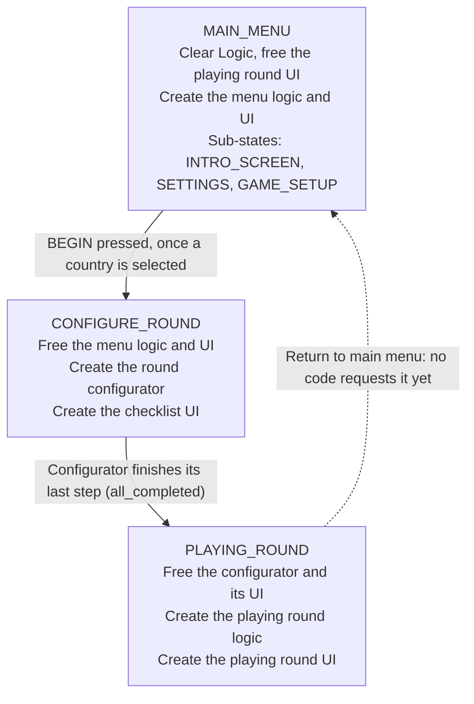

# Politics: Project Onboarding

Politics is a 4X-style strategy game built in Godot 4.5 (Forward Plus). Today it runs from a main menu through country selection and round setup into a playing-round shell.

- **Working now:** pick one of six countries (America, China, Germany, Israel, Russia, UK), press BEGIN, and watch the round get assembled with two random opponents. You land in a playing round where END TURN steps through the countries in initiative order. After the last country the phase advances and the turns start over.
- **Stubbed:** the phases (economic, proxy war, upkeep) have names and a cycle but no gameplay behind them, and nothing starts the first phase yet (see Known gaps).
- **Focus so far:** the state progression from menu to round, and the turn and phase system, built so each piece has one job and can be swapped or extended without touching the others.

## Project layout

Scenes are grouped by game state, and scripts are split into a logic tree and a UI tree that mirror each other.

| Path | What lives there |
| --- | --- |
| `Data/Country_Data/` | One JSON file per country, with `id`, `country_name` and `initiative` (1 to 5). Adding a file adds a country to the selection list. |
| `Scenes/main_scene.tscn` | The entry scene (`run/main_scene`): `StateRouter`, `Logic`, `UI`. |
| `Scenes/MainMenu/` | `Core/` holds the menu logic and UI scenes. `Panels/` holds the round config panel and its country entry. |
| `Scenes/ConfigureRound/` | Everything that exists while a round is assembled: the round config node, the round configurator (logic and UI), the country manager, the state manager. |
| `Scenes/PlayingRound/` | `playing_round_logic.tscn` and `playing_round_ui.tscn`. |
| `Scenes/country.tscn` | One country instance, with `Data` and a `Parameters` tree. |
| `Scripts/Autoload/game_state.gd` | The only autoload (`GameState`). |
| `Scripts/Logic/` | `state_router.gd`, `round_config.gd`, and one folder per area: `MainMenu/`, `RoundConfigurator/`, `PlayingRound/`. |
| `Scripts/UI/` | UI scripts, one folder per area: `MainMenu/`, `ConfigureRound/`, `PlayingRound/`. |
| `Scripts/Country/` | `Countries/country.gd` and `CountryManager/` (manager, logic, factory, list). |
| `Scripts/MainScene/` | `main_scene.gd` and `logic.gd`, the registry (see below). |
| `Scripts/PlayerManager/` | `player_data.gd`, the data node on each country. |

Two scripts sit outside this pattern: `Scenes/MainMenu/Buttons/new_game_button.gd` lives beside the scenes, and `Scripts/MainMenu/Panels/begin_button.gd` lives in a `MainMenu` folder at the scripts root.

## Architecture principles

Every piece has one job, is handed what it needs, and is created and freed by the same owner.

- **Logic and UI are separate scenes.** Each state has a logic scene (added under `Logic`) and a UI scene (added under `UI`). UI scripts read from logic through `initialize(...)`; logic never reaches into UI.
- **Dependencies are injected.** The creator calls `initialize(...)` with what the new node needs. A node does not search the tree for its collaborators. The one lookup a script makes is `@onready` on its own children.
- **Systems are registered, not found.** Anything that must be reachable by others registers with the `Logic` node (`logic.register("name", node)`) and is read with `logic.get_system("name")`.
- **Wiring uses signals, set up in the scene.** Example: the entry factory emits `entry_created`, and a `[connection]` in `round_config_panel.tscn` routes it to the selector.
- **The router owns meta-game states only.** Main menu, configure round, playing round (credits and the like later). Setup that exists only briefly belongs in the round configurator.
- **Small scripts over big ones.** A new concern gets a new script, even a short one. Existing scripts do not grow code that does not belong to them.

## Main scene and the Logic registry

`main_scene.tscn` holds a `StateRouter`, a `Logic` node that doubles as a registry of live systems, a `UI` control and a `Node3D`. On startup `main_scene.gd` calls `state_router.initialize(logic, ui)`.

`Logic` (`Scripts/MainScene/logic.gd`) keeps a `systems` dictionary and has four functions:

- `register(name, node)` stores a system.
- `get_system(name)` returns it, or `null`.
- `release(name)` removes one system from the registry and the tree, then frees it.
- `clear()` empties the registry and frees every child of `Logic`. Children leave the tree immediately, so a node of the same name created in the same frame keeps its name.

| Name | Registered by | Freed by |
| --- | --- | --- |
| `main_menu` | Router, when the main menu is created | Router on `CONFIGURE_ROUND` |
| `round_config` | Router, when setup opens | Round configurator when its checklist completes |
| `round_configurator` | Router, on `CONFIGURE_ROUND` | Router on `PLAYING_ROUND` |
| `country_manager` | `CreateCountryManager` step | `logic.clear()` on `MAIN_MENU` |
| `state_manager` | `CreateStateManager` step | `logic.clear()` on `MAIN_MENU` |
| `playing_round` | Router, on `PLAYING_ROUND` | `logic.clear()` on `MAIN_MENU` |

The UI side is not covered by `clear()`. The router keeps its own references to the main menu UI, the round config panel, the checklist UI and the playing round UI, and frees them itself.

## State flow

The game moves through three states in `GameState`, and `state_router.gd` reacts to each change by creating the new state's scenes and freeing the old one's.

Only two things request a state change today: the BEGIN button asks for `CONFIGURE_ROUND`, and the configurator asks for `PLAYING_ROUND` when its last step is done. `GameState` is global; `MainMenuState` lives inside the menu scene and only changes which panel shows.

What happens, in order:

1. **Startup.** `main_scene.gd` calls `state_router.initialize(logic, ui)`, which runs the `MAIN_MENU` branch for the initial state.
2. **Opening setup.** NEW GAME moves `MainMenuState` to `GAME_SETUP`. The router adds the round config panel. The global state stays `MAIN_MENU`.
3. **BEGIN.** With a country selected, the button requests `CONFIGURE_ROUND`. `GameState.change_state` sets the state and emits `state_changed`.
4. **Configure.** The router frees the menu, then creates the round configurator and its checklist UI. The configurator builds the systems and the player's country.
5. **Handoff.** On `all_completed` the configurator releases the round config and requests `PLAYING_ROUND`.
6. **Play.** The router frees the configurator and its UI, then creates the playing round logic and UI, wired to the systems already in the registry.

## Main menu and round config panel

The main menu is a logic scene plus a UI scene, and its own small state machine (`INTRO_SCREEN`, `SETTINGS`, `GAME_SETUP`) decides which panel is showing.

- **`main_menu_logic.tscn`** holds `MainMenuState` (the sub-state machine; `ui_cancel` calls `go_back()` through `MainMenuInput`).
- **`main_menu_ui.tscn`** holds the NEW GAME button and a `Panels` node that other panels are added to.
- NEW GAME changes the menu state to `GAME_SETUP`. The router listens to `MainMenuState.state_changed`, creates the round config node (once), and adds the round config panel under `Panels`. Going back to `INTRO_SCREEN` or `SETTINGS` frees the panel.

The round config panel (`round_config_panel.tscn`) is a logic-and-UI pair in one scene:

| Node | Script | Job |
| --- | --- | --- |
| `RoundConfig` (root) | `round_config_panel.gd` | Receives the config and passes it to the three nodes below. |
| `Logic/CountryEntryFactory` | `country_entry_factory.gd` | Reads each country JSON listed in the config, builds one entry per country, and puts them in the list. |
| `Logic/CountrySelector` | `country_selector.gd` | Listens to every entry, records that a selection happened, and writes the chosen id to the config. |
| `Panel/BeginButton` | `begin_button.gd` | Does nothing until the selector reports a selection, then requests `CONFIGURE_ROUND`. |
| Each entry (`round_config_country_container.tscn`) | `round_config_country_entry.gd` | A toggle button in a shared `ButtonGroup`. Shows the country name and emits `selected(id)` when pressed. |

How a click becomes a stored choice:

1. `round_config_panel.initialize(config)` hands the selector to the button, the config to the selector, and the config plus the list node to the factory.
2. For each file in `config.country_files`, the factory parses the JSON, instantiates an entry, calls `entry.initialize(country_data, group)`, emits `entry_created(entry)`, and adds it to the list.
3. A scene connection routes `entry_created` to `CountrySelector.track_entry`, which connects the entry's `selected` signal to the selector.
4. Pressing an entry emits `selected(id)`. The selector sets `has_selection` and calls `config.select_country(id)`, which stores `player_country_id`.
5. BEGIN checks `has_selection`. If true, it requests `GameState.State.CONFIGURE_ROUND`.

A rebuilt panel gets a new selector, so `has_selection` always starts false.

## Round configurator

The round configurator runs a list of steps in order, builds the systems a round needs, creates the player's country and the opponents, sets the turn order, and then hands the game to the playing round. It exists only during `CONFIGURE_ROUND`.

**Structure.** `round_configurator_logic.tscn` is a `RoundConfigurator` node whose children are the steps. Scene-tree order is execution order. Each step is a node with a script that has one function, `run(configurator)`. The configurator exposes `logic` (its parent, the registry) and `config` (the registered `round_config` node), so a step reaches everything through the configurator.

| Order | Step node | Script | What it does |
| --- | --- | --- | --- |
| 1 | `CreateCountryManager` | `create_country_manager_step.gd` | Instantiates the country manager under `Logic`, registers it as `country_manager`, and calls its `initialize()`. |
| 2 | `CreateStateManager` | `create_state_manager_step.gd` | Instantiates the state manager (with `TurnManager` and `PhaseManager`) under `Logic` and registers it as `state_manager`. |
| 3 | `CreatePlayerCountry` | `create_player_country_step.gd` | Connects the factory's `country_created` signal to `TurnManager.add_player`, then creates the country whose id is `config.player_country_id`. |
| 4 | `CreatePlayers` | `create_players_manager.gd` | Picks `config.player_count - 1` random countries (never the player's) and creates them through the factory, so they register with the turn manager. `player_count` is 3 and is not yet editable in the panel. |
| 5 | `SetTurnOrder` | `set_turn_order_step.gd` | Sorts the created countries by `country_initiative`, highest first (ties keep creation order), passes the order to `TurnManager.set_turn_order()`, then calls `next_turn()` so the top country is current. |

**How it runs.**

- `_ready()` defers `run_steps()` by one step, so steps can add systems to `Logic` after the configurator has finished entering the tree.
- `run_steps()` loops over its children and runs `await step.run(self)`. A step is complete when `run()` returns. A step that needs time awaits a signal or timer inside `run()`.
- After each step the configurator emits `step_completed(step)`. After the last step it emits `all_completed`.
- On `all_completed` the configurator releases the `round_config` node and requests `GameState.State.PLAYING_ROUND`. The router then frees the configurator and its children.

**Checklist UI.** `round_configurator_ui.tscn` is created by the router next to the configurator. For each step it adds a read-only checkbox labelled with the step's node name (for example, `CreateCountryManager` shows as "Create Country Manager") and ticks it on `step_completed`. The steps know nothing about the UI.

## Playing round

The playing round does not own its systems. It is a thin scene that receives the country manager, and its UI is wired to the state manager the configurator already built.

- **Logic (`playing_round_logic.tscn`).** A `PlayingRound` node with an `EventCoordinators` child that holds `GameInitializer`. The router calls `initialize(country_manager)`, which passes the manager down to the initializer. `GameInitializer` only stores it so far.
- **Systems.** The country manager and state manager were created and registered during configure. The router reads `state_manager` from the registry and takes `turn_manager` and `phase_manager` from it.
- **UI (`playing_round_ui.tscn`).** The router calls `initialize(state_manager, phase_manager, turn_manager)`. `PhaseLabel` and `TurnLabel` each draw their current value on initialize and update on `phase_changed` and `turn_changed`. `TurnLabel` reads the current country from `TurnManager.get_current_turn()` and shows "STANDBY" when there is none. The end-turn button (`Buttons/EndTurnButton`) holds the state manager and calls `state_manager.turn_manager.next_turn()`.
- **Teardown.** The router frees the UI on `MAIN_MENU`. `logic.clear()` frees the playing round logic, the country manager and the state manager together.

## Turn and phase system

`state_manager.tscn` holds `TurnManager` and `PhaseManager`, and its root script (`states.gd`) keeps the round counter. The managers never reference each other. Three `[connection]` entries in the scene link them:

| Signal | From | To |
| --- | --- | --- |
| `all_turns_completed` | `TurnManager` | `PhaseManager.next_phase` |
| `phase_changed` | `PhaseManager` | `TurnManager.start_turns` (`unbinds=1`, since `start_turns` takes no argument) |
| `cycle_completed` | `PhaseManager` | `StateManager._on_phase_manager_cycle_completed`, which adds 1 to `current_round` |

- **`TurnManager`** holds `turn_order` (country names) and `current_turn_index`. `set_turn_order()` replaces the order. `start_turns()` resets the index to -1 and selects the first country. `next_turn()` moves to the next country. Past the last one it resets the index to -1, emits `all_turns_completed` and does not emit `turn_changed`. `get_current_turn()` returns the current name, or `null`.
- **`PhaseManager`** builds its cycle from the `RoundPhase` enum with `STANDBY` filtered out, so the enum is the only list of phases. `next_phase()` goes to the next phase and emits `cycle_completed` first when `UPKEEP_PHASE` wraps to `ECONOMIC_PHASE`. Leaving `STANDBY` does not emit it.
- **`StateManager`** holds `current_round` (starts at 0), `set_round(n)` and the `round_changed(new_round)` signal.

One END TURN press, in order:

1. The button calls `next_turn()`.
2. After the last country, `all_turns_completed` fires and `next_phase()` advances the phase.
3. `phase_changed` calls `start_turns()`, so the first country is up in the new phase.
4. After `UPKEEP_PHASE`, `cycle_completed` fires and the round counter goes up.

The turn order is computed once, during `SetTurnOrder`. It does not change between phases.

## How to extend

**Add a round setup step**

1. Write a script with `func run(configurator)`. Reach other systems through `configurator.logic.get_system("name")` and the config through `configurator.config`.
2. Add a child node with that script under `RoundConfigurator` in `round_configurator_logic.tscn`. Its position among the children is its place in the order.
3. Nothing else changes: the checklist UI picks up the new node by name, and the configurator emits `step_completed` for it.

**Add a system that lives for the round**

1. Make a scene for it.
2. Add a step that instantiates it under `Logic`, calls `logic.register("name", node)`, and runs any `initialize()` it needs.
3. Read it elsewhere with `logic.get_system("name")`. `logic.clear()` frees it on `MAIN_MENU`.

**Add a top-level game state (credits, for example)**

1. Add a value to `GameState.State`.
2. Add a branch in `state_router.gd`'s `_on_state_changed`, plus `create_` and `destroy_` functions that follow the existing ones: logic through the registry, UI through a router variable.
3. Have something request it with `GameState.state_change_requested.emit(...)`.

**Add a main menu panel**

1. Add a value to `MainMenuState.State`.
2. Handle it in the router's `_on_menu_state_changed`, creating the panel under `main_menu_ui_instance.panels`.

**Add a country**

- Drop a JSON file with `id`, `country_name` and `initiative` into `Data/Country_Data/`. The factory reads `initiative` unconditionally, so a file without it errors. It appears in the selection list the next time the panel opens.

## Known gaps and next steps

The round setup flow is complete end to end in code, but several parts are placeholders. Items marked "from reading the code" have not been confirmed by running the game.

- **No way back to the main menu.** The router's `MAIN_MENU` branch (clear `Logic`, rebuild the menu) exists, but no code requests that state after startup.
- **Steps finish instantly.** All the configurator steps are synchronous, so the whole configure state runs in one frame and the checklist UI is replaced before it can be seen. It becomes visible once a step awaits something.
- **Round config creation lives in the router.** The router creates the round config node and panel when the menu enters `GAME_SETUP`. The intended owner is the main menu itself.
- **Same-state guards do nothing.** In `GameState.change_state` and `PhaseManager.advance_phase`, the `if current == new: pass` check does not return, so a repeated request still emits.
- **No first phase.** Nothing moves `PhaseManager` off `STANDBY`. Planned: a final configurator step that calls `next_phase()` and `set_round(1)`, and replaces the `next_turn()` call in `SetTurnOrder`. Until then the phase becomes `ECONOMIC_PHASE` only after the first full pass of END TURN, and `current_round` stays 0 until the first full cycle completes.
- **Fixed turn order.** Initiative is read once at setup. Re-sorting each phase means moving the sort out of `SetTurnOrder` into runtime code that can see the country nodes.
- **Player count is fixed.** `RoundConfig.player_count` is 3. The panel does not expose it, and opponents are always random, with no per-opponent choice.
- **Step script name.** The `CreatePlayers` node still uses `create_players_manager.gd`, so the node and file names differ.
- **Nothing listens to `round_changed`.** There is no round label yet.
- **Stubs.** `GameInitializer` stores the country manager and does nothing; the phases have names and a cycle but no behaviour.
- **Open editor error.** The editor reports `Could not resolve script "res://Scripts/Logic/round_config.gd"` at line 7 of `country_factory.gd`. The file exists at that path and the cause has not been found.
